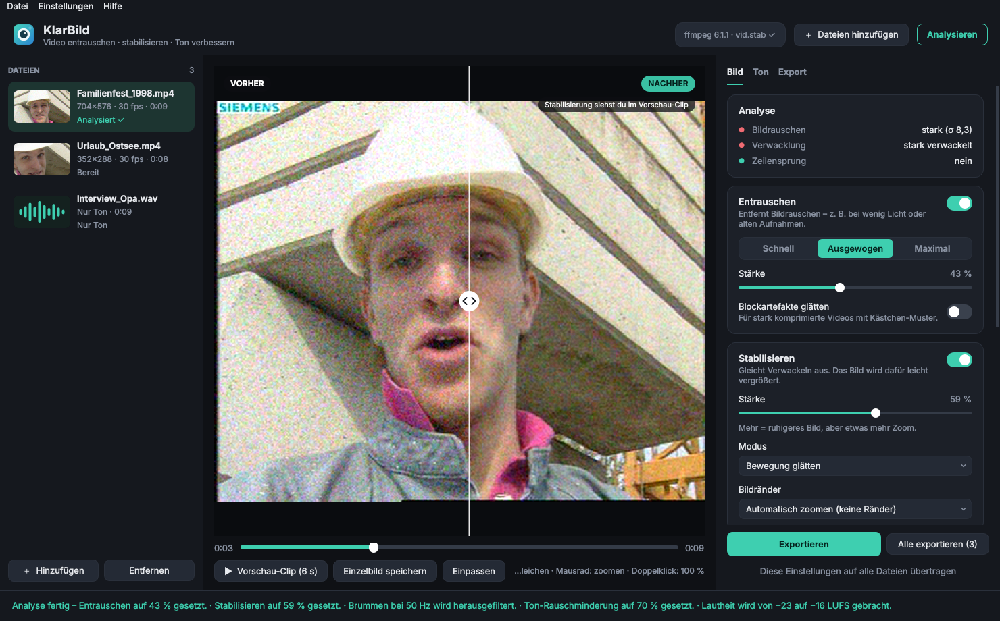

# KlarBild

Desktop-Programm zum **Entrauschen und Stabilisieren von Videos** und zur **Verbesserung des Tons**.
Für Familienvideos, VHS/DV-Digitalisate, Handyaufnahmen bei wenig Licht und Interviews.



## Funktionen

**Bild**
- **Entrauschen** in drei Stufen: *Schnell* (hqdn3d), *Ausgewogen* (FFT-Entrauschen über mehrere Bilder),
  *Maximal* (mehr Überlappung plus zeitliche Nachglättung)
- **Stabilisieren** mit vid.stab in zwei Durchläufen: „Bewegung glätten“ oder „Stativ“, automatischer
  Zoom gegen Ränder. Ohne vid.stab wird ersatzweise `deshake` verwendet.
- **Zeilensprung** (VHS, DV) wird erkannt und entfernt, auf Wunsch mit doppelter Bildrate
- Blockartefakte glätten, Schärfen, Helligkeit, Kontrast, Sättigung, Ausgabegröße
- HDR-Videos (z. B. vom iPhone) werden nach SDR umgerechnet, wenn ffmpeg das kann

**Ton**
- Netzbrummen (50/60 Hz samt Obertönen), Rumpeln, Rauschen, Knackser, Übersteuerung
- Sprache verständlicher machen, Dynamik angleichen
- **Lautheit** auf −14 / −16 / −23 LUFS, gemessen in zwei Durchläufen (EBU R128)
- **Hörprobe** Vorher/Nachher direkt im Programm

**Analyse** (ein Klick): misst Bildrauschen, Verwacklung, Zeilensprung, Lautheit, Grundrauschen,
Brummen und Übersteuerung und stellt alle Regler passend ein.

**Vorschau**: Vorher/Nachher-Ansicht mit verschiebbarem Teiler und Zoom bis zur Pixelebene,
dazu ein 6-Sekunden-Vorschau-Clip mit allen Einstellungen inklusive Stabilisierung.

**Export**

| Format | Wofür |
|---|---|
| MP4 · H.264 | läuft überall |
| MP4 · H.265 (HEVC) | etwa halb so groß, ideal für Apple-Geräte |
| MOV · ProRes 422 (HQ/422/LT) | Schnittprogramme (Final Cut, Resolve, Premiere) |
| MKV · FFV1 + FLAC | verlustfreies Archiv |
| WebM · VP9 + Opus | Web |
| Vorher/Nachher-Video | Original und Ergebnis nebeneinander, beschriftet |
| Nur Ton: WAV (24 Bit), FLAC, M4A, MP3 | Ton weiterverarbeiten oder teilen |
| Einzelbild (PNG/JPEG) | aus der Vorschau |

Dazu kommen drei Qualitätsstufen, optionale Hardware-Beschleunigung auf dem Mac (VideoToolbox) und eine
**Warteschlange für viele Dateien** („Alle exportieren“). Vorhandene Dateien werden nie überschrieben.
Reine Tondateien bekommen bei einem Videoformat automatisch das passende Tonformat.

## Fertige Mac-App (Apple-Chip)

GitHub baut die App bei jedem Push auf den Branch `klarbild` (Workflow „KlarBild für macOS bauen“):
- Ein ffmpeg mit vid.stab wird mit allen Bibliotheken eingepackt; Homebrew ist auf deinem Mac nicht nötig.
- Die Tests laufen auf einem echten Mac.
- Die fertige App wird mit verstecktem Homebrew per Selbsttest gestartet.

So startest du die heruntergeladene App:
1. `KlarBild-macOS-AppleSilicon.zip` entpacken und `KlarBild.app` in den Programme-Ordner ziehen.
2. Die App ist nicht bei Apple notarisiert. Beim ersten Start einmal im Terminal ausführen:
   `xattr -dr com.apple.quarantine /Applications/KlarBild.app`
   Alternativ: öffnen, dann Systemeinstellungen → Datenschutz & Sicherheit → „Dennoch öffnen“.
3. Selbsttest bei Bedarf: `/Applications/KlarBild.app/Contents/MacOS/KlarBild --selftest`

## Installation aus dem Quelltext (macOS)

```bash
brew install ffmpeg            # oder: brew install ffmpeg-full (mehr Filter)
git clone <dieses Repo> && cd klarbild
python3 -m venv .venv && source .venv/bin/activate
pip install -r requirements.txt
python3 main.py
```

KlarBild sucht ffmpeg automatisch: zuerst in `ffmpeg-full`, dann im PATH, dann unter `/opt/homebrew/bin` und
`/usr/local/bin`. Varianten mit vid.stab werden bevorzugt. Oben rechts zeigt das Programm an, welches ffmpeg
verwendet wird; ein Klick darauf wählt ein anderes. Läuft dort „vid.stab ✗“, stabilisiert KlarBild mit
dem einfacheren `deshake`. Abhilfe schafft dann `brew install ffmpeg-full` oder ein anderes ffmpeg mit vid.stab.

Linux und Windows funktionieren ebenso (ffmpeg aus der Paketverwaltung bzw. als `ffmpeg.exe` im PATH).

### Selbst als Mac-App bauen

```bash
./tools/bundle_ffmpeg_macos.sh   # optional: ffmpeg portabel nach vendor/ (braucht Homebrew)
./build_app.sh                   # erzeugt dist/KlarBild.app
```

## Bedienung

1. Videos oder Tonaufnahmen ins Fenster ziehen.
2. **Analysieren** klicken: Die Regler werden passend gesetzt.
3. Im Bild mit der Maus vergleichen. Mausrad zoomt, ein Doppelklick zeigt 100 %. Die Stabilisierung
   zeigt der **Vorschau-Clip**, den Ton die **Hörprobe** im Tab „Ton“.
4. Format im Tab **Export** wählen, dann **Exportieren** oder **Alle exportieren**.

Einstellungen gelten pro Datei. „Diese Einstellungen auf alle Dateien übertragen“ kopiert sie auf alle anderen.

## Wie die Filter abgestimmt wurden

Die Zuordnungen „Regler → Filterparameter“ sind gemessen, nicht geraten:

- **Entrauschen**: Die Xiph-Testsequenz *Foreman* bekam künstliches Rauschen (3 Stärken). Alle Verfahren wurden per
  PSNR/SSIM gegen das saubere Original verglichen. `fftdnoiz` lieferte bei mittlerem Rauschen +6 dB PSNR in etwa 10 %
  der Rechenzeit von `nlmeans`. `nlmeans` wurde deshalb verworfen: Bei Full HD bräuchte es rund eine Stunde pro
  Videominute.
- **Blockraster**: `fftdnoiz` hinterlässt ein feines 16-px-Raster, weil die Filterwirkung um 28 % schwankt,
  nach dem Schärfen um 44 %. KlarBild rechnet deshalb ein zweites Mal mit versetztem Raster und mittelt beide.
  Danach bleiben 4–10 %; pixelweise Filter liegen bei 1,6 %.
- **Rauschmessung**: Schätzer nach Immerkær (1996), blockweise auf zwei Bildgrößen. So wird auch grobes,
  „fleckiges“ Rauschen von hochskaliertem SD-Material erkannt.
- **Verwacklung**: Phasenkorrelation zwischen aufeinanderfolgenden Bildern. Gemessen wird das Zittern der
  Kamerabahn, nicht gewollte Schwenks. Testclips: ruhig 0,01 · Schwenk 0,10 · leichtes Zittern 0,7 · starkes
  Zittern 1,9. vid.stab senkt starkes Zittern um 94 %.
- **Ton**: Testaufnahme mit Sprache, 50-Hz-Brummen samt Obertönen und Rauschen. Brummen sank von 42 dB auf 7 dB
  über Grund, der Rauschabstand stieg von 11 auf 33 dB, die Lautheit landete bei −16,0 LUFS (Ziel −16).

## Lizenzen und kommerzielle Nutzung

KlarBild verwendet nur Bausteine, die kommerzielle Nutzung erlauben:

| Baustein | Lizenz | Anmerkung |
|---|---|---|
| ffmpeg (inkl. vid.stab, x264, x265 …) | LGPL / GPL je nach Build | wird als **eigenes Programm aufgerufen**, nicht gelinkt |
| Qt for Python (PySide6) | LGPLv3 | dynamisch gelinkt (PyInstaller-„onedir“) |
| NumPy | BSD-3 | |

Bewusst **nicht** verwendet werden KI-Modelle mit „nur nicht-kommerziell“-Lizenz (z. B. CodeFormer,
ProPainter, Upscale-A-Video).

Hinweise für den Vertrieb:
- Die fertige Mac-App enthält das Homebrew-ffmpeg (GPL-Build, ohne „nonfree“-Teile) samt Bibliotheken. Für eigene
  Nutzung spielt das keine Rolle. Wer die App weitergibt oder verkauft, muss die Bedingungen der GPL für dieses
  ffmpeg erfüllen, z. B. den Quelltext anbieten. Statische Builds ohne vid.stab oder „nonfree“-Builds (z. B. für
  Homebridge) wurden deshalb bewusst nicht verwendet.
- Für H.264/H.265 können beim kommerziellen Vertrieb Patentlizenzen eine Rolle spielen.
- Das ist keine Rechtsberatung. Vor einem Verkauf bitte prüfen lassen.

## Tests

```bash
pip install pytest
python3 -m pytest -q
```

Die 31 Tests erzeugen ihr Testmaterial selbst mit ffmpeg (verwackelt, verrauscht, Brummton, Zeilensprung).
Geprüft werden:
- alle Exportformate
- die Wirkung der Filter: Rauschen −78 %, Zittern −95 %, Brummen unter der Erkennungsschwelle, Lautheit auf ±1 LU genau
- Abbruch mitten im Export
- die Oberfläche (ohne Bildschirm)

## Aufbau

```
klarbild/
  ffmpeg_tools.py    ffmpeg finden, Fähigkeiten prüfen, ffprobe, Ausführen mit Fortschritt/Abbruch
  video_filters.py   Bildfilter-Ketten
  audio_filters.py   Tonfilter-Ketten, Lautheit in zwei Durchläufen
  analysis.py        Messungen und Empfehlungen
  exporters.py       Formate, Codecs, Dateinamen
  pipeline.py        ein Export-Auftrag von Anfang bis Ende
  preview.py         Vorschaubilder, Hörprobe, Vorschau-Clip
  gui/               Oberfläche (PySide6)
tests/               pytest
```

## Grenzen

- Kein KI-Hochskalieren. Der Schwerpunkt liegt auf Entrauschen und Stabilisieren. Real-ESRGAN (BSD-3) ließe sich
  später als zusätzlicher Schritt ergänzen.
- Stabilisieren vergrößert das Bild leicht (bei „Automatisch zoomen“), damit keine Ränder entstehen.
- Die Einzelbild-Vorschau zeigt keine Stabilisierung. Dafür gibt es den Vorschau-Clip.
